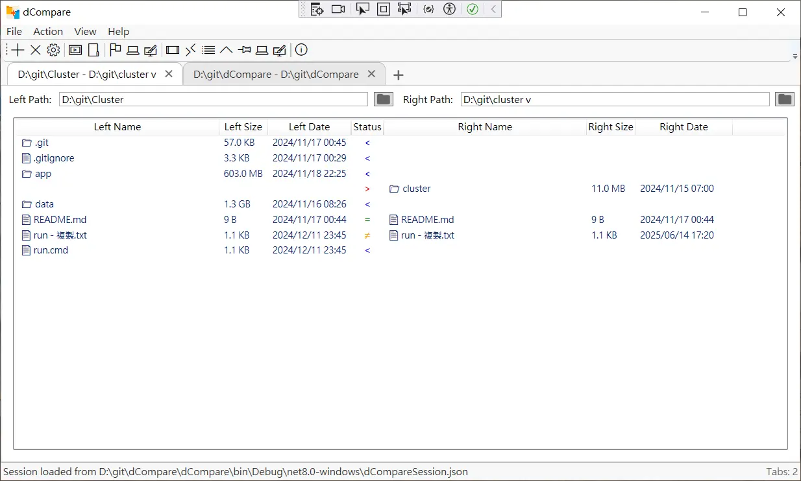

# dCompare - A Directory/File Comparision Tool

## Disclose

\*\* Disclose: lots code of this project (I think more than 80%) are generated by AI. \*\*

## Features (Directory/File comparison)

- Compare directory
- Copy/Move between directories
- Simple file content comparison

## Features in the future

- 左右邊 context menu 不一樣
- External file content comparison (e.g call WinMerge)
- Simple image comparison
- archive file comparison (maybe use https://github.com/icsharpcode/SharpZipLib ?)
- json comparision
- Associate to file explorer

## New options

- choose double click to compare or show content
- diff viewer: choose by file extension?
- external editor path (default: %windir%\NOTEPAD.EXE)

## Issues

- Cannot change the width of column?
- Cannot use mouse to partial select some text of the text box

## Development

### Requirements

- .NET8 is requred because I use [OpenFolderDialog](https://learn.microsoft.com/zh-tw/dotnet/api/microsoft.win32.openfolderdialog?view=windowsdesktop-8.0) to select the folder.
- [DiffPlex](https://github.com/mmanela/diffplex): provide text file comparison.
- [Serilog]()

# 文件複製方法比較 (by ChatGPT)

以下表格比較了在 .NET 8 中使用 `CopyFileEx`、`.NET File.Copy` 和 `FileStream` 三種方法進行文件和目錄複製的特性，針對需求：Windows 10 或以上、複製目錄、需要進度回調、保留元數據（如時間戳）、無複製視窗。

| **特性**                | **CopyFileEx**                                                                                                                                                                                                                                                                                                                                                  | **.NET File.Copy**                                                                                                                                                                                                                                          | **FileStream**                                                                                                                                                                                                                                                                                                                                                                                                                  |
| ----------------------- | --------------------------------------------------------------------------------------------------------------------------------------------------------------------------------------------------------------------------------------------------------------------------------------------------------------------------------------------------------------- | ----------------------------------------------------------------------------------------------------------------------------------------------------------------------------------------------------------------------------------------------------------- | ------------------------------------------------------------------------------------------------------------------------------------------------------------------------------------------------------------------------------------------------------------------------------------------------------------------------------------------------------------------------------------------------------------------------------- |
| **描述**                | Windows API 函數（`kernel32.dll`），低級文件複製，接近 `explorer.exe` 行為。                                                                                                                                                                                                                                                                                    | .NET 8 高級方法，封裝底層 API，簡單易用。                                                                                                                                                                                                                   | .NET 低級流式 I/O 類，靈活控制文件讀寫。                                                                                                                                                                                                                                                                                                                                                                                        |
| **平台支持**            | 僅限 Windows（符合 Windows 10+ 需求）。                                                                                                                                                                                                                                                                                                                         | 跨平台（Windows、Linux、macOS）。                                                                                                                                                                                                                           | 跨平台（Windows、Linux、macOS）。                                                                                                                                                                                                                                                                                                                                                                                               |
| **複製目錄**            | 需手寫遞歸遍歷文件和子目錄。                                                                                                                                                                                                                                                                                                                                    | 需手寫遞歸遍歷文件和子目錄。                                                                                                                                                                                                                                | 需手寫遞歸遍歷文件和子目錄。                                                                                                                                                                                                                                                                                                                                                                                                    |
| **進度回調**            | **支持**：通過 `lpProgressRoutine` 提供單文件複製進度（已複製字節數），需手動計算目錄總進度。                                                                                                                                                                                                                                                                   | **不支持**：無進度回調，需改用 `FileStream` 手動計算。                                                                                                                                                                                                      | **支持**：通過計算已讀寫字節數實現，需手動累計目錄總進度。                                                                                                                                                                                                                                                                                                                                                                      |
| **取消功能**            | **支持**：通過 `pbCancel` 布林值中途終止，類似 `explorer.exe` 取消按鈕。取消後需清理不完整文件。                                                                                                                                                                                                                                                                | **不支持**：除非異常，無法中途終止，需等待完成或終止進程。                                                                                                                                                                                                  | **支持**：通過 `CancellationToken` 在異步讀寫中實現，取消後需清理不完整文件。                                                                                                                                                                                                                                                                                                                                                   |
| **元數據保留**          | **自動保留**：創建時間、修改時間、訪問時間、文件屬性（如只讀、隱藏）默認保留，無需額外代碼。                                                                                                                                                                                                                                                                    | **不保留**：目標文件時間戳設為當前時間，需用 `FileInfo` 手動設置（約 3-4 行/文件）。                                                                                                                                                                        | **不保留**：需用 `FileInfo` 手動設置元數據，與 `File.Copy` 相同。                                                                                                                                                                                                                                                                                                                                                               |
| **效能**                | **略優**：直接調用 Windows API，無 .NET 運行時開銷，速度最快（差距 <1-2%）。                                                                                                                                                                                                                                                                                    | **略弱**：封裝底層 API，有少量 .NET 開銷。                                                                                                                                                                                                                  | **略弱**：.NET 流管理和運行時開銷，速度略低於 `CopyFileEx`，可通過調整緩衝區優化。                                                                                                                                                                                                                                                                                                                                              |
| **內存使用**            | 流式複製，緩衝區大小由系統控制（通常 4KB-64KB），適合大文件。                                                                                                                                                                                                                                                                                                   | 流式複製，緩衝區由 .NET 管理，內存占用相近。                                                                                                                                                                                                                | 流式複製，緩衝區大小可自定義（例如 8KB），內存占用相近。                                                                                                                                                                                                                                                                                                                                                                        |
| **異步支持**            | 同步 API，需通過 `Task` 封裝異步。                                                                                                                                                                                                                                                                                                                              | 同步方法，無原生異步，需改用 `FileStream`。                                                                                                                                                                                                                 | **原生支持**：`ReadAsync`/`WriteAsync` 提供異步，適合現代應用。                                                                                                                                                                                                                                                                                                                                                                 |
| **易用性**              | **較複雜**：需 P/Invoke，實現進度/取消功能需處理回調和錯誤碼。                                                                                                                                                                                                                                                                                                  | **最簡單**：直接調用，異常處理符合 .NET 風格，但元數據需額外代碼。                                                                                                                                                                                          | **複雜**：需手動管理緩衝區、進度、取消和元數據，代碼量較多。                                                                                                                                                                                                                                                                                                                                                                    |
| **錯誤處理**            | 使用 Windows 錯誤碼（`GetLastWin32Error`），需查閱文檔，調試較繁瑣。                                                                                                                                                                                                                                                                                            | .NET 異常（`IOException` 等），清晰易讀，調試友好。                                                                                                                                                                                                         | .NET 異常，與 `File.Copy` 相同，易於調試。                                                                                                                                                                                                                                                                                                                                                                                      |
| **模擬 `explorer.exe`** | **最接近**：自動保留元數據，支持取消和進度回調，行為類似 `explorer.exe`。                                                                                                                                                                                                                                                                                       | **較弱**：需手動設置元數據，無進度/取消支持，模擬效果差。                                                                                                                                                                                                   | **中等**：支持進度和取消，但元數據需手動設置，模擬效果不如 `CopyFileEx`。                                                                                                                                                                                                                                                                                                                                                       |
| **無複製視窗**          | **滿足**：純 API，無 GUI。                                                                                                                                                                                                                                                                                                                                      | **滿足**：無 GUI。                                                                                                                                                                                                                                          | **滿足**：無 GUI。                                                                                                                                                                                                                                                                                                                                                                                                              |
| **代碼示例（單文件）**  | `csharp [DllImport("kernel32.dll", SetLastError = true, CharSet = CharSet.Auto)] private static extern bool CopyFileEx(string lpExistingFileName, string lpNewFileName, IntPtr lpProgressRoutine, IntPtr lpData, ref bool pbCancel, uint dwCopyFlags); bool cancel = false; CopyFileEx(source, dest, IntPtr.Zero, IntPtr.Zero, ref cancel, 0); ` | `csharp File.Copy(source, dest, true); FileInfo destInfo = new FileInfo(dest); destInfo.CreationTime = sourceInfo.CreationTime; destInfo.LastWriteTime = sourceInfo.LastWriteTime; destInfo.LastAccessTime = sourceInfo.LastAccessTime; ` | `csharp using FileStream sourceStream = File.OpenRead(source); using FileStream destStream = File.Create(dest); byte[] buffer = new byte[8192]; while ((bytesRead = await sourceStream.ReadAsync(buffer, 0, buffer.Length, token)) > 0) {     await destStream.WriteAsync(buffer, 0, bytesRead, token); } FileInfo destInfo = new FileInfo(dest); destInfo.CreationTime = sourceInfo.CreationTime; ` |
| **針對需求評價**        | **最佳**：滿足所有需求（進度、取消、元數據、無 GUI），效能略優，代碼適中。                                                                                                                                                                                                                                                                                      | **不適合**：無進度/取消支持，元數據需手動設置，不滿足需求。                                                                                                                                                                                                 | **可行但次優**：支持進度和取消，但元數據需手動設置，代碼複雜，效能略低。                                                                                                                                                                                                                                                                                                                                                        |

## 針對需求（Windows 10+、目錄複製、進度回調、元數據保留）的建議

- **首選 `CopyFileEx`**：
  - 自動保留元數據，無需額外代碼。
  - 原生支持進度回調（`lpProgressRoutine`）和取消（`pbCancel`），適合目錄複製和用戶交互。
  - 效能略優，與 `explorer.exe` 行為最接近。
  - 參考實現：前述 `DirectoryCopier` 類（包含目錄遞歸、進度、取消）。
- **次選 `FileStream`**：
  - 支持進度和取消，適合偏好 .NET 原生 API 或未來跨平台。
  - 元數據需手動設置，代碼較複雜，效能略低。
  - 參考實現：前述 `FileStream` 目錄複製示例。
- **避免 `File.Copy`**：
  - 無進度或取消支持，無法滿足需求。
  - 用 Task Manager 終止進程可行，但不推薦，因可能導致不完整文件或數據不一致，無清理邏輯。

## 注意事項

- **取消後清理**：`CopyFileEx` 和 `FileStream` 取消後需刪除不完整文件/目錄，防止殞留垃圾數據。
- **進度回調頻率**：測試大目錄或網絡路徑，確保回調頻率不過高，可限制更新頻率優化性能。
- **權限**：確保對源文件有讀權限，對目標路徑有寫權限。
- **UI 集成**：若需進度條，將進度回調連接到 UI 更新（例如 WPF/WinForms）。
